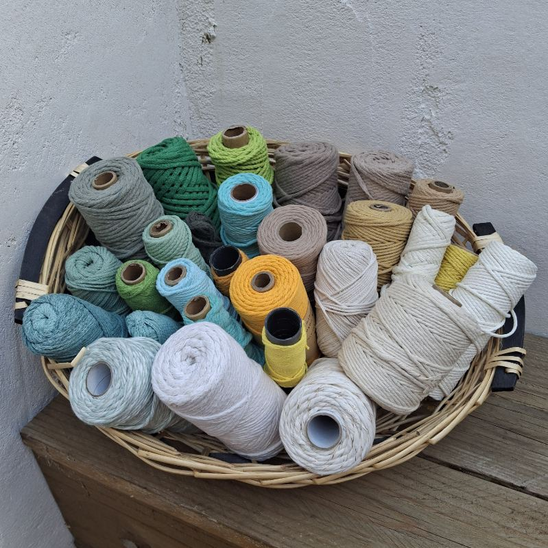
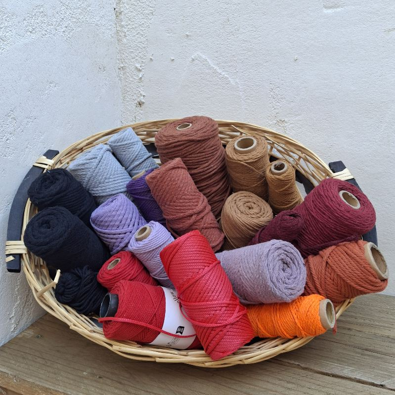

## L'atelier

MAM'CRAM, c'est nous deux : un couple de complices, quatre mains et beaucoup de cordes. Ici, rien ne presse. On prend le temps de nouer, de défaire quand le rendu ne nous plaît pas, et de recommencer jusqu'à ce que la pièce soit juste.

Chaque nœud est serré à la main, à la bonne tension : assez pour que la création tienne des années, assez souple pour qu'elle garde cette douceur qu'on aime sous les doigts.

## Les matières

Tout commence dans nos paniers, où s'entassent des bobines de coton de toutes les couleurs : des tons chauds, rouille, bordeaux ou camel, et d'autres plus frais, sauge, turquoise ou écru. Nous choisissons un coton de qualité supérieure, doux au toucher et qui garde sa tenue avec le temps.

Le bois, lui, vient de nos balades : bois flotté ramassé sur les grèves catalanes, branches de forêt ou bois de récupération. On le lave, on le laisse sécher, puis on le ponce avant qu'il rejoigne l'atelier. Aucun morceau ne ressemble à un autre, et c'est souvent lui qui décide de la forme de la pièce.

## Fait main, sur commande

La plupart de nos créations naissent d'une demande. Une couleur qui irait bien dans votre salon, une taille précise pour un mur, un prénom pour accueillir un bébé : on adapte, on vous montre, on ajuste ensemble.

Une idée, un cadeau à faire, ou simplement l'envie d'en parler ? [Écrivez-nous](/contact/), on vous répond rapidement. Et peut-être qu'on se croisera sur un marché !
